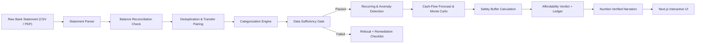
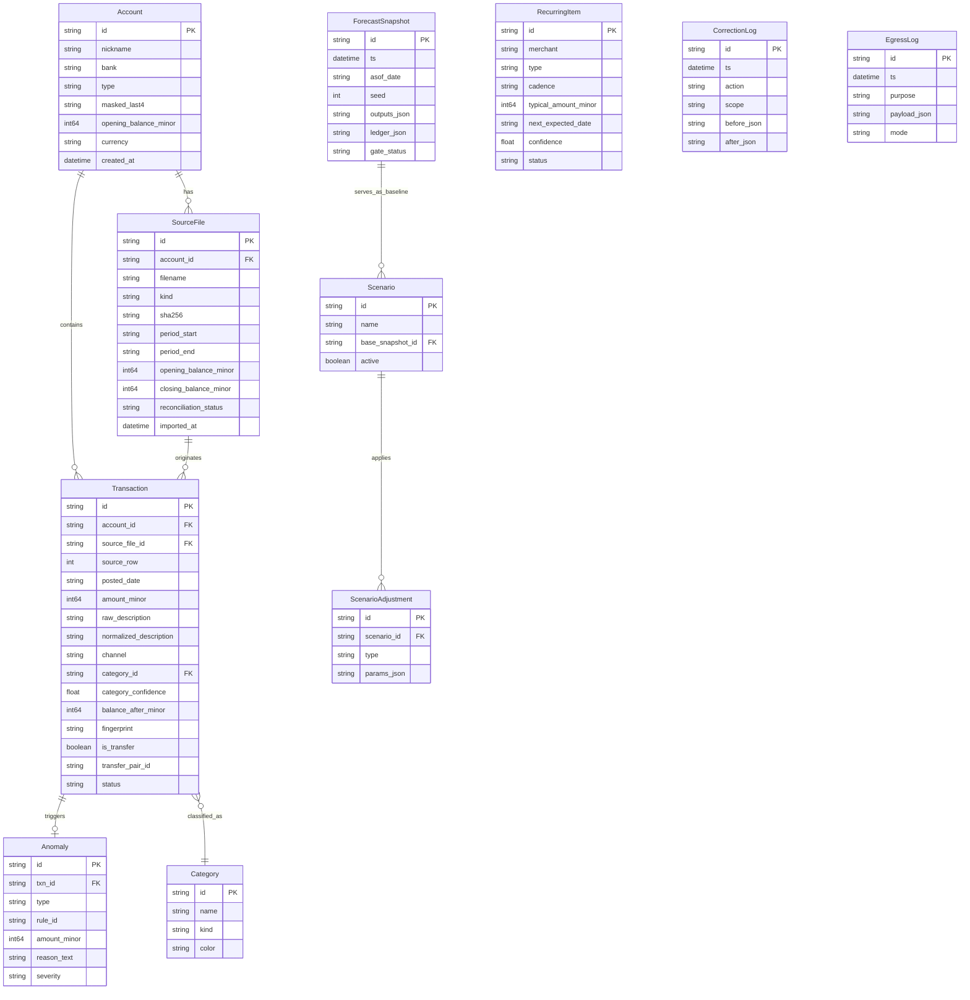

# System Architecture — Financial Decision Lab (FDL)

This document provides a comprehensive technical blueprint of the Financial Decision Lab (FDL) architecture. It is designed to help AI agents and human engineers understand component boundaries, data lifecycles, and architectural invariants.

---

## 1. Architectural Philosophy & Principles

Financial Decision Lab is built upon four non-negotiable architectural pillars:

1. **Separation of Computation and Language**:
   Financial decisions must be rigorous, auditable, and mathematically provable. All calculations (cash flow projections, recurring item cadences, anomaly scoring, Monte Carlo simulations, safety buffers, and headroom) are executed strictly in deterministic Python code. The AI / LLM is relegated strictly to natural language parsing and template narration.
2. **The Reasoning Ledger as the Universal Truth**:
   Every financial verdict is accompanied by a discrete step-by-step audit trail (`LedgerStep`). Every step specifies its inputs, formula, output value in integer paise, and provenance back to raw transactions.
3. **Data Sufficiency Before Advice**:
   The system implements a strict "Sufficiency Gate" inspired by medical triage: if the input data lacks required history (< 90 days), contains activity gaps (> 7 days), lacks detectable income, or fails balance reconciliation, the system refuses to output a speculative verdict.
4. **Local-First & Zero Leakage**:
   Financial bank statements contain sensitive personal identifiable information (PII). By default, processing is 100% on-device (`PRIVACY_MODE=local`). Any network egress must pass through an audited gate and be recorded in the `egress_log` table.

---

## 2. High-Level System Architecture

```mermaid
flowchart TD
    subgraph Client ["Client Layer (apps/web)"]
        UI["Next.js 14 App Router UI"]
        State["Zustand State Store"]
        Charts["Recharts Visualizations"]
        UI --> State
        State --> Charts
    end

    subgraph API ["API & Engine Layer (apps/api)"]
        Router["FastAPI REST Routers"]
        
        subgraph IngestionEngine ["Ingestion & Normalization"]
            Parser["Statement Parsers (CSV / PDF)"]
            Dedupe["Deduplication & Internal Transfer Matcher"]
            Categorizer["Classifier & Rule Categorizer"]
        end

        subgraph CoreEngine ["Deterministic Financial Engine"]
            Gate["Data Sufficiency Gate"]
            Recurring["Recurring Cadence Detector"]
            Anomaly["Robust Anomaly Detector"]
            CashFlow["Cash Flow & Monte Carlo Sampler"]
            Buffer["Safety Buffer Calculator"]
            Decision["Affordability Evaluator"]
            Ledger["Reasoning Ledger Builder"]
        end

        subgraph AIGuard ["AI & Narration Guard"]
            NLP["NL Query Parser"]
            Narrator["Narrative Generator"]
            Guard["Number-Verification Guard"]
        end
    end

    subgraph Storage ["Storage Layer"]
        DB[(SQLite Database / SQLAlchemy 2.0)]
    end

    subgraph Shared ["Shared Contracts (packages/shared)"]
        Contracts["TypeScript Interfaces, Constants & formatINR"]
    end

    UI <-->|HTTP / JSON (Paise)| Router
    Contracts -.->|Shared types| UI
    Router --> IngestionEngine
    Router --> CoreEngine
    Router --> AIGuard
    IngestionEngine --> DB
    CoreEngine --> DB
    NLP --> Router
    Decision --> Ledger
    Ledger --> Guard
    Guard --> Narrator
```

---

## 3. End-to-End Data Pipeline

When a user imports statements or asks a financial question, the system processes data through an explicit, multi-stage pipeline:



### Pipeline Stages
1. **Raw Ingestion**: Bank statements (CSV or PDF) are uploaded. A SHA-256 fingerprint is generated to prevent duplicate file uploads.
2. **Parsing & Reconciliation**: The parser extracts rows, standardizes dates to `YYYY-MM-DD`, converts amounts to integer paise (positive = credit, negative = debit), and verifies:
   $$\text{Opening Balance} + \sum \text{Transactions} = \text{Closing Balance}$$
3. **Deduplication & Transfer Pairing**:
   - Overlapping date imports are merged via exact content hashing and rolling window matching.
   - Offsetting debits and credits between known user accounts within $\pm 2$ days are tagged as `is_transfer = True` to prevent double-counting expenses.
4. **Categorization**: Transactions are matched against merchant rules, regex patterns, and machine learning classifiers (Naive Bayes / TF-IDF). Users can override categories, which logs to `correction_log` and propagates to similar merchants.
5. **Sufficiency Gate Evaluation**: Checks for 90 days of continuous data, maximum gap $\le 7$ days, verified income streams, and balance reconciliation.
6. **Financial Engine Execution**:
   - Computes cadence and predictability of recurring obligations (rent, EMI, SIP, subscriptions).
   - Detects outliers using Median Absolute Deviation (MAD) / Modified Z-Scores.
   - Projects daily cash balances over a 90-day horizon using Monte Carlo simulation (5,000 runs) with explicit seeds.
   - Calculates the dynamic safety buffer $B = \max(\text{Floor}, k \times \text{Essentials}, \text{VariabilityReserve})$.
7. **Affordability Verdict & Ledger Generation**:
   - Compares projected balance against safety buffer under P10 (conservative), P50 (median), and P90 (optimistic) scenarios.
   - Formulates the structured `Reasoning Ledger` detailing each step of the calculation.
8. **Narration & Guard Verification**:
   - Optional LLM generates plain-text summary from the ledger.
   - `guard.py` verifies with regex that every numeric figure in the narration exists in the ledger. If any discrepancy is found, it reverts to a deterministic template string.

---

## 4. Entity-Relationship Data Model

The persistence layer is implemented in SQLite using SQLAlchemy 2.0 ORM models in `apps/api/db/models.py`.



---

## 5. Subsystem Breakdown

### 5.1 Ingestion & Parsing Subsystem (`apps/api/parsers/`)
- **`csv_parser.py`**: Heuristically detects header rows, delimiter (comma/tab/semicolon), date formats (DD/MM/YYYY vs YYYY-MM-DD), and credit/debit column pairs. Includes preconfigured bank profiles for HDFC, SBI, ICICI, and Axis Bank.
- **`pdf_parser.py`**: Uses `pdfplumber` to extract statement tables, handle multi-page continuations, and extract opening/closing balance metadata from header blocks.

### 5.2 Deduplication & Normalization Subsystem (`apps/api/ml/`)
- **Fingerprinting**: Generates a stable hash per transaction:
  $$\text{fingerprint} = \text{SHA256}(\text{account\_id} + \text{posted\_date} + \text{amount\_minor} + \text{normalized\_description} + \text{occurrence\_index})$$
- **Transfer Detection**: Searches for complementary pairs ($A_1 + A_2 = 0$ or within standard transfer fee tolerance $\le ₹25$) across distinct accounts within a $\pm 2$ day window.
- **Normalization**: Cleans noisy payment gateway descriptions (e.g., `UPI/50849204928/Swiggy Bangalore/swiggy@icici` $\rightarrow$ `Swiggy`, channel `UPI`).

### 5.3 Deterministic Financial Engine (`apps/api/engine/`)
- **`sufficiency.py`**: Executes the 4 mandatory sufficiency checks and returns a `SufficiencyReport`.
- **`recurring.py`**: Groups transactions by merchant and detects cadences (weekly, monthly, annual) using inter-arrival interval analysis. Computes coefficient of variation (CV) and confidence scores.
- **`anomaly.py`**: Flags anomalies using modified Z-scores:
  $$M_i = \frac{0.6745 \cdot |x_i - \tilde{x}|}{\text{MAD}}$$
  Also flags first-time merchants with charges $> ₹1,500$ and sudden duplicate charges within 3 days.
- **`forecast.py`**: Simulates daily cash flow over 90 days. Decomposes spend into committed recurring obligations and sampled variable spending (Monte Carlo with 5,000 iterations). Produces P10, P50, and P90 cash balance paths.
- **`buffer.py`**: Computes the dynamic safety buffer:
  $$B = \max(\text{Floor}, k \times \text{Essentials}, \text{VariabilityReserve})$$
  Where $k$ dynamically scales based on income volatility ($k = 1.0$ for stable salary, $k = 1.5$ for variable income, $k = 2.0$ for irregular freelance income).
- **`affordability.py`**: Evaluates whether a proposed purchase causes projected cash balance to breach the safety buffer or dip below zero. Assigns verdicts: `AFFORDABLE`, `TIGHT`, `NOT_ADVISABLE`, `NOT_AFFORDABLE`, or `INSUFFICIENT_DATA`. Builds the complete `Reasoning Ledger`.

### 5.4 What-If Simulation Subsystem (`apps/api/routers/whatif.py`)
- Allows users to test alternatives without modifying raw transaction data:
  - **Scenario A**: Pay with cash upfront vs 3/6/12 month EMI.
  - **Scenario B**: Delay purchase by 1, 2, or 3 months.
  - **Scenario C**: Cancel specific recurring subscriptions.
  - **Scenario D**: Income shock (-20% freelance reduction).
- Calculates differential impact on lowest projected balance and buffer headroom.

### 5.5 AI & Number-Verification Guard Subsystem (`apps/api/ai/`)
- **`extractor.py`**: Translates natural language questions (e.g., *"Can I buy a ₹95,000 MacBook next month on a 6-month EMI?"*) into structured `AffordabilityQuery` parameters.
- **`narrator.py`**: Synthesizes a human-readable explanation from the structured verdict and ledger.
- **`guard.py`**: Scans the generated narrative using regular expressions to extract every numeric value. Verifies that every number matches an exact figure present in the `Reasoning Ledger`. Replaces unverified text with a deterministic fallback template.

---

## 6. Frontend Architecture (`apps/web`)

### Directory Structure & Routes
- `/`: **Financial Dashboard** — Net worth summary, essentials vs discretionary ratio, safety buffer status, spending trends, and quick-ask bar.
- `/lab`: **Affordability & What-If Lab** — Interactive purchase evaluator, side-by-side scenario comparisons (Cash vs EMI vs Delay), and expandable Reasoning Ledger.
- `/transactions`: **Transaction Ledger** — Searchable, filterable list of all transactions with category override controls and bulk rule application.
- `/recurring`: **Recurring Commitments** — Active subscriptions, EMIs, SIPs, and cadences with pause/cancel what-if toggles.
- `/anomalies`: **Anomaly Review** — Flagged outliers, duplicate charges, and unexpected price increases with user feedback buttons.
- `/privacy`: **Privacy & Egress Audit** — View privacy status (Local-Only vs Hybrid) and inspect the cryptographic log of all external calls.

### State & Contract Integration
- Frontend imports domain types and formatting utilities directly from `@fdl/shared`.
- All monetary values are delivered over HTTP as integer paise.
- Currency rendering is handled exclusively by `formatINR(paise, showPaise)`:
  ```typescript
  import { formatINR } from '@fdl/shared';
  // formatINR(8000000) -> "₹80,000"
  // formatINR(-500000) -> "-₹5,000"
  ```

---

## 7. Security, Privacy & Compliance

1. **Zero External Data Egress by Default**: `PRIVACY_MODE=local`. All database queries, parsing, and math run in the local Python process.
2. **Audit Logging**: Any call to external services (e.g. Groq or Ollama) must record:
   - Timestamp (UTC)
   - Redacted request payload (no account numbers, names, or raw transaction text)
   - Destination endpoint
3. **Data Anonymization**: If hybrid mode is enabled, statements are scrubbed of masked account numbers and merchant transaction IDs before sending prompt contexts.
