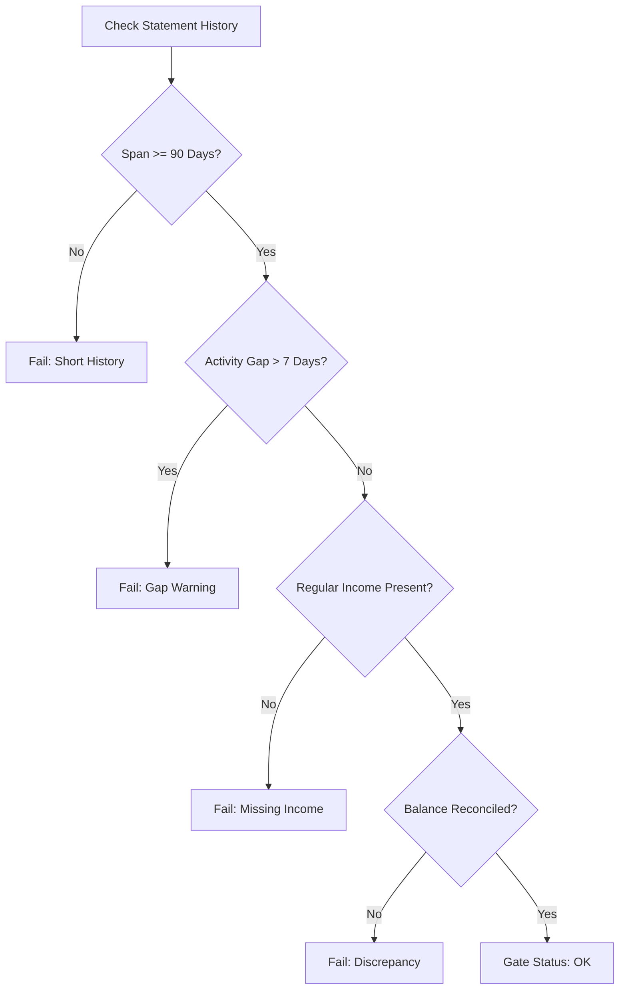
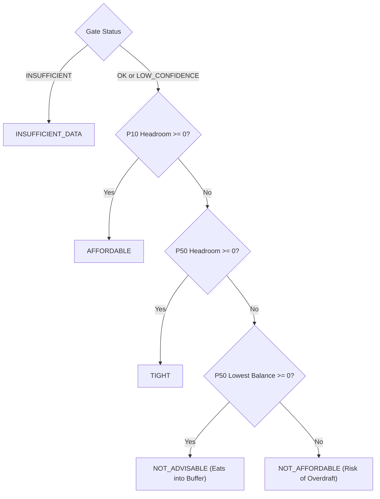

# Domain & Financial Engine Specification

This specification provides the exact mathematical formulas, algorithms, threshold constants, and pseudocode needed to implement or extend the deterministic computation engines in `apps/api/engine/`.

---

## 1. Domain Constants Reference

All threshold constants are defined in `@fdl/shared` (`packages/shared/src/constants/index.ts`) and must be mirrored in backend Python engines:

| Parameter | Value | Unit | Description |
|---|---|---|---|
| `MIN_HISTORY_DAYS` | 90 | Days | Minimum statement duration for full confidence |
| `MAX_TOLERATED_GAP_DAYS` | 7 | Days | Maximum consecutive inactive days before flagging gap |
| `STALENESS_LIMIT_DAYS` | 45 | Days | Statement is considered stale if last transaction is older |
| `UNCATEGORIZED_WARNING_PCT` | 30 | % | Sufficiency warning if uncategorized spend exceeds this |
| `TRANSFER_DATE_TOLERANCE_DAYS` | 2 | Days | Window to match debit/credit internal transfers |
| `TRANSFER_FEE_TOLERANCE_PAISE` | 2500 | Paise (₹25) | Max discrepancy tolerated for IMPS/NEFT fees |
| `DUPLICATE_CHARGE_WINDOW_DAYS`| 3 | Days | Window to flag identical amounts at same merchant |
| `ANOMALY_MODIFIED_Z_THRESHOLD`| 3.5 | Score | Modified Z-score threshold for spend outliers |
| `NEW_MERCHANT_MIN_AMOUNT_PAISE`| 150000 | Paise (₹1,500) | Threshold to alert on first-time merchant |
| `RECURRING_MIN_MONTHLY_OCCUR` | 3 | Count | Min occurrences to confirm monthly cadence |
| `MONTE_CARLO_RUNS` | 5000 | Iterations | Simulation sample size |
| `DEFAULT_FORECAST_HORIZON_DAYS`| 90 | Days | Projection horizon |
| `BUFFER_FLOOR_PAISE` | 500000 | Paise (₹5,000)| Absolute minimum safety buffer floor |
| `BUFFER_K_STABLE` | 1.0 | Multiplier | $k$ for salaried user with $CV \le 0.10$ |
| `BUFFER_K_VARIABLE` | 1.5 | Multiplier | $k$ for variable income with $0.10 < CV \le 0.30$ |
| `BUFFER_K_IRREGULAR` | 2.0 | Multiplier | $k$ for irregular income with $CV > 0.30$ |

---

## 2. Ingestion & Data Normalization Algorithms

### 2.1 Deduplication & Fingerprinting

Every transaction generates a deterministic hash fingerprint:
$$\text{fingerprint} = \text{SHA256}(\text{account\_id} \mathbin{\Vert} \text{posted\_date} \mathbin{\Vert} \text{amount\_minor} \mathbin{\Vert} \text{normalized\_description} \mathbin{\Vert} \text{occurrence\_index})$$

#### Deduplication Rules
1. If an incoming transaction matches an existing transaction on `account_id`, `posted_date`, and `amount_minor`:
   - Compare `normalized_description` using Levenshtein similarity or normalized string equality.
   - If match $\ge 0.85$, identify as duplicate.
   - Mark duplicate status as `merged` and record original `source_row` in `merged_from_json`.

### 2.2 Internal Transfer Detection

Internal transfers between a user's own accounts (e.g., Savings A $\rightarrow$ Savings B) distort cash flows if treated as expenses.

#### Detection Algorithm
Given two transactions $T_1$ and $T_2$ where $T_1.\text{account\_id} \ne T_2.\text{account\_id}$:
1. Verify opposite signs:
   $$\operatorname{sgn}(T_1.\text{amount\_minor}) \ne \operatorname{sgn}(T_2.\text{amount\_minor})$$
2. Date window check:
   $$|T_1.\text{posted\_date} - T_2.\text{posted\_date}| \le 2\text{ days}$$
3. Amount match (with fee tolerance):
   $$|T_1.\text{amount\_minor} + T_2.\text{amount\_minor}| \le \text{TRANSFER\_FEE\_TOLERANCE\_PAISE}$$
4. If conditions met:
   - Set $T_1.\text{is\_transfer} = \text{True}$ and $T_2.\text{is\_transfer} = \text{True}$.
   - Link via `transfer_pair_id`.
   - Assign category `cat_transfer` (kind: `system`).

---

## 3. Recurring Transaction Detection Algorithm

To model committed expenses (rent, EMI, SIP, subscriptions, utilities), we detect periodic payment cadences.

### Step 1: Merchant & Amount Grouping
Group active debit transactions by `merchant_id` (or normalized merchant text). For each merchant group:
- Sort transactions chronologically: $t_1, t_2, \dots, t_N$.
- Compute inter-arrival intervals: $\Delta d_i = t_{i+1}.\text{date} - t_i.\text{date}$ (in days).

### Step 2: Cadence Classification
Let $\widetilde{\Delta d} = \operatorname{median}(\Delta d)$ and $\sigma_{\Delta d} = \operatorname{std}(\Delta d)$.

| Cadence | Expected Interval Range | Min Occurrences |
|---|---|---|
| **Weekly** | $6 \le \widetilde{\Delta d} \le 8$ days | 4 |
| **Fortnightly** | $13 \le \widetilde{\Delta d} \le 16$ days | 3 |
| **Monthly** | $27 \le \widetilde{\Delta d} \le 34$ days | 3 |
| **Quarterly** | $85 \le \widetilde{\Delta d} \le 95$ days | 2 |
| **Annual** | $350 \le \widetilde{\Delta d} \le 380$ days | 2 |

### Step 3: Confidence Score Formula
Confidence is computed on a 0.0 to 1.0 scale:
$$\text{confidence} = 0.4 \cdot C_{\text{count}} + 0.3 \cdot C_{\text{cadence}} + 0.3 \cdot C_{\text{amount}}$$

Where:
- $C_{\text{count}} = \min(1.0, \frac{N}{\text{target\_occurrences}})$
- $C_{\text{cadence}} = \max\left(0.0, 1.0 - \frac{\sigma_{\Delta d}}{\widetilde{\Delta d}}\right)$
- $C_{\text{amount}} = \max\left(0.0, 1.0 - \frac{\operatorname{IQR}(\text{amounts})}{\operatorname{median}(\text{amounts})}\right)$

If $\text{confidence} \ge 0.65$, register into `recurring_items`.

---

## 4. Robust Outlier & Anomaly Detection

To prevent seasonal spikes or unusual one-off purchases from skewing recurring baselines, use Median Absolute Deviation (MAD) rather than standard deviation (which is heavily distorted by outliers).

### 4.1 Modified Z-Score Formula
For a transaction amount $x_i$ in category $C$:
$$\text{MAD} = \operatorname{median}(|x_i - \tilde{x}|)$$
$$\text{Modified Z-Score } M_i = \frac{0.6745 \cdot |x_i - \tilde{x}|}{\text{MAD}}$$

Where:
- $\tilde{x} = \operatorname{median}(x)$
- If $M_i > 3.5$, flag transaction as `large_amount` anomaly.

### 4.2 New Merchant Alert
Flag transaction as `new_merchant` if:
1. Merchant has never appeared in the historical ledger before.
2. Transaction amount $> ₹1,500$ ($150,000$ paise).

### 4.3 Sudden Duplicate Charge Alert
Flag transaction as `duplicate_charge` if:
1. Same `merchant_id` and exact same `amount_minor`.
2. Occurs within $\le 3$ calendar days.
3. Not recognized as an active recurring subscription or EMI.

---

## 5. Data Sufficiency Gate Engine

The sufficiency gate runs before any forecast or decision is calculated:



### The 4 Mandatory Checks

1. **History Length Check (`history_length`)**:
   - $\text{Total Days} = \text{max\_date} - \text{min\_date} + 1$.
   - Pass: $\ge 90$ days.
   - Warning: $60 - 89$ days.
   - Fail: $< 60$ days.
2. **Date Continuity Check (`date_gaps`)**:
   - Check if there exists any interval between consecutive transactions $> 7$ days.
   - If found, record start and end date of the gap.
3. **Income Credit Check (`income_present`)**:
   - At least 2 recurring credit transactions labeled as `cat_income_salary` or `cat_income_freelance`.
4. **Balance Anchor Check (`balance_anchor`)**:
   - Verify that $\text{opening\_balance} + \sum \text{amount\_minor} = \text{closing\_balance}$ for each imported statement file.

### Gate Verdict Mapping
- **`OK`**: All 4 checks passed. Full confidence forecast permitted.
- **`LOW_CONFIDENCE`**: History 60–89 days, or uncategorized spend $> 30\%$. Verdict returned with widened percentile intervals and explicit warnings.
- **`INSUFFICIENT`**: History $< 60$ days, unresolvable gap, or no detectable income. Decision engine halts and returns remediation actions (e.g. "Upload 3 more months of statements").

---

## 6. Cash-Flow Forecast & Monte Carlo Sampler

The projection model simulates day-by-day cash balance for $H = 90$ days starting from current date $T_0$.

### 6.1 Daily Balance Evolution Equation
For each simulation day $t \in [1, H]$:
$$\text{Balance}(t) = \text{Balance}(t-1) + I(t) - C(t) - V(t)$$

Where:
- $\text{Balance}(0) = \sum \text{current balances across user accounts}$.
- $I(t)$: Expected income on day $t$ (projected from recurring salary/contract dates).
- $C(t)$: Committed recurring expenses scheduled on day $t$ (rent, EMI, SIP, subscriptions).
- $V(t)$: Discretionary variable spending sampled from historical distributions.

### 6.2 Monte Carlo Variable Spend Sampling
1. For variable spending categories (Food, Shopping, Transport, Entertainment):
   - Fit historical daily spend to an empirical or Gamma/Lognormal distribution.
2. Run $N = 5,000$ iterations with seed `seed = 42`.
3. In each run $k \in [1, N]$:
   - Generate sample path $\text{Balance}^{(k)}(t)$ for $t = 1 \dots H$.
   - Find minimum projected cash balance:
     $$B_{\min}^{(k)} = \min_{t \in [1, H]} \text{Balance}^{(k)}(t)$$
4. Extract percentiles across all 5,000 runs:
   - **P10 (Worst-case / 10th percentile)**: $B_{\min}$ exceeded 90% of the time.
   - **P50 (Median expectation)**: $B_{\min}$ median.
   - **P90 (Optimistic expectation)**: $B_{\min}$ 90th percentile.

---

## 7. Dynamic Safety Buffer Formula

The safety buffer $B$ represents the minimum cash reserve the user must preserve to avoid financial distress.

### Buffer Equation
$$B = \max\left( \text{Floor}, \; k \times \text{Essentials}_{\text{monthly}}, \; \text{VariabilityReserve} \right)$$

Where:
- $\text{Floor} = 500,000\text{ paise } (₹5,000.00)$.
- $\text{Essentials}_{\text{monthly}} = \text{median monthly spend on rent, bills, groceries, EMIs}$.
- $k$: Volatility multiplier determined by the Coefficient of Variation ($CV$) of income:
  $$CV_{\text{income}} = \frac{\sigma_{\text{income}}}{\mu_{\text{income}}}$$

| Income Volatility | $CV$ Range | Multiplier $k$ | Rationale |
|---|---|---|---|
| **Stable Salary** | $CV \le 0.10$ | $k = 1.0$ | Predictable monthly paycheck; 1 month essentials suffices. |
| **Variable Income** | $0.10 < CV \le 0.30$ | $k = 1.5$ | Freelance or bonus variance; 1.5 months essentials required. |
| **Irregular Income** | $CV > 0.30$ | $k = 2.0$ | Volatile contractor income; 2.0 months buffer essential. |

---

## 8. Affordability Decision Matrix

Given a purchase amount $P$ occurring next month:

### Headroom Calculation
For each percentile tier $X \in \{10, 50, 90\}$:
$$\text{Headroom}_X = B_{\min, X} - B - P$$

Where:
- $B_{\min, X}$: Projected minimum balance at percentile $X$.
- $B$: Dynamic safety buffer.
- $P$: Proposed purchase outflow.

### Verdict Classification Rules



| Verdict Code | Mathematical Condition | User Interpretation |
|---|---|---|
| **`AFFORDABLE`** | $\text{Headroom}_{10} \ge 0$ | Safe under conservative (P10) conditions without threatening buffer. |
| **`TIGHT`** | $\text{Headroom}_{50} \ge 0$ and $\text{Headroom}_{10} < 0$ | Affordable under median expectations, but breaches buffer if income dips. |
| **`NOT_ADVISABLE`** | $\text{Headroom}_{50} < 0$ but $B_{\min, 50} \ge 0$ | Leaves user with less than their safety buffer; emergency risk. |
| **`NOT_AFFORDABLE`** | $B_{\min, 50} < 0$ (Prob of negative balance $> 25\%$) | High risk of negative balance, overdraft, or missed commitments. |
| **`INSUFFICIENT_DATA`** | Gate Status is `INSUFFICIENT` | System refuses to guess; requests missing statement data. |

---

## 9. What-If Simulation Algorithms

### 9.1 EMI Amortization Formula
When user tests financing the purchase via EMI over $n$ months at annual interest rate $r$:
- Monthly interest rate: $i = \frac{r}{12 \times 100}$.
- Monthly installment in paise:
  $$\text{EMI} = \operatorname{round}\left( P \times \frac{i \cdot (1 + i)^n}{(1 + i)^n - 1} \right)$$
- If zero interest ($r = 0$): $\text{EMI} = \operatorname{round}(P / n)$.
- Simulation adjusts cash flow: replaces one-time $-P$ with $- \text{EMI}$ for months $1 \dots n$.

### 9.2 Delay Purchase Adjustment
If purchase delayed by $m$ months:
- Shifts the negative cash flow from month $T$ to month $T + m$.
- Recalculates projected lowest balance date and new headroom.

### 9.3 Subscription Cancellation
- Removes chosen recurring debit items from $C(t)$ over the simulation horizon.
- Frees cumulative cash: $\Delta \text{Cash} = \sum_{\text{canceled}} \text{Amount}_j \times \text{Occurrences}$.

---

## 10. Number-Verification Guard Algorithm

The guard (`apps/api/ai/guard.py`) guarantees zero LLM numeric hallucinations:

```python
import re

def verify_narrative_numbers(narrative_text: str, ledger: list[dict]) -> bool:
    """
    Extracts all numeric representations from narrative_text (e.g. ₹80,000, 80k, 24%, 1.5x)
    and verifies that each extracted figure is mathematically equivalent to an input
    or output number in the Reasoning Ledger.
    """
    # 1. Collect all authorized numbers from ledger
    authorized_values = set()
    for step in ledger:
        val = step.get("value_minor")
        if val is not None:
            authorized_values.add(abs(val))
            authorized_values.add(abs(val) // 100) # Rupees
        # add multiplier k, breach probabilities, etc.
    
    # 2. Extract numbers from narrative
    matches = re.findall(r'(?:₹\s*|Rs\.?\s*)?([0-9]+(?:,[0-9]{2,3})*(?:\.[0-9]+)?)', narrative_text)
    
    for m in matches:
        clean_num = float(m.replace(',', ''))
        # Check against authorized_values within tolerance
        if not any(abs(clean_num - auth) < 1.0 for auth in authorized_values):
            return False # Reject! Unverified number found!
            
    return True
```
