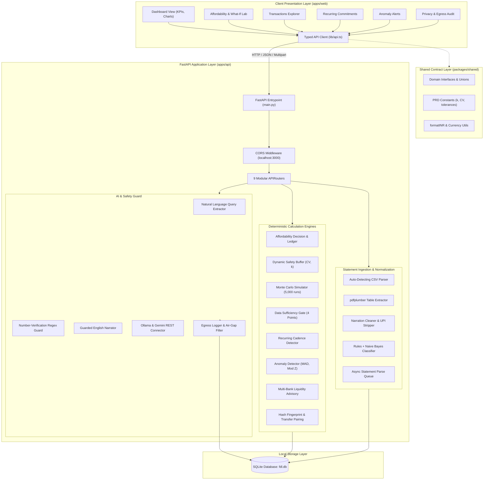
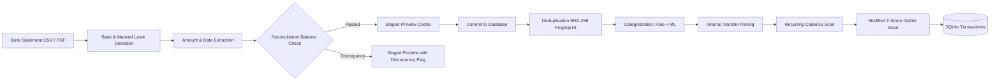
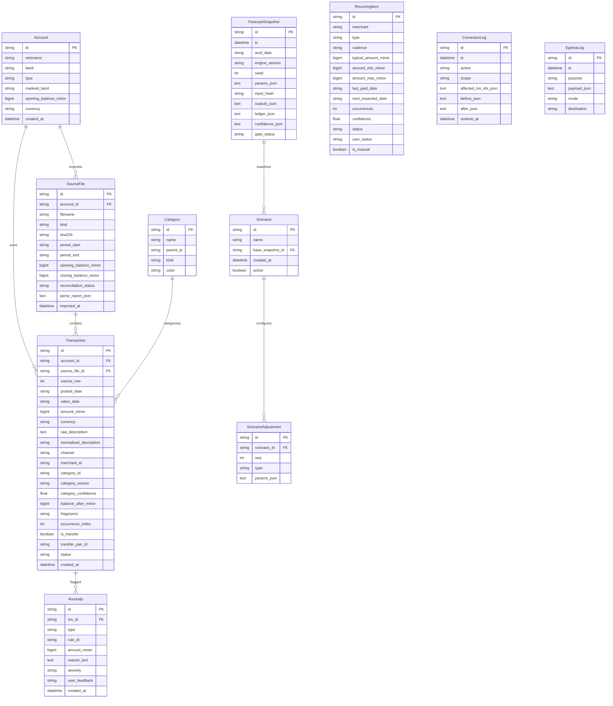

# System Architecture Audit — Financial Decision Lab (FDL)

**Audit Date**: October 2026  
**Auditor**: Senior Software Architect  
**Scope**: High-Level System Architecture, Component Interactions, Data Pipelines, and Security Boundaries  

---

## 1. High-Level Architecture Overview

Financial Decision Lab is designed with a **decoupled, multi-tier architecture** adhering to strict local-first and deterministic invariants:

---

## 2. Component Relationships & Responsibilities

### 2.1 Presentation Tier (`apps/web`)
- **Technology**: Next.js 14.2+ (App Router), React 18, Tailwind CSS, Framer Motion, Recharts.
- **Role**: Renders financial dashboards, interactive What-If scenario comparisons, transaction lists, upcoming payment calendars, and anomaly warnings.
- **Rule**: Never calculates financial balances or headroom. Always displays formatted currency (`formatINR`) sourced from integer paise.

### 2.2 Contract Tier (`packages/shared`)
- **Technology**: TypeScript 5.7, Zod 3.24.
- **Role**: Single source of truth for:
  - `MinorAmount`: Integer paise representation of money.
  - Domain constants: `BUFFER_K_STABLE = 1.0`, `BUFFER_K_VARIABLE = 1.5`, `BUFFER_K_IRREGULAR = 2.0`, `MIN_HISTORY_DAYS = 90`, `MAX_TOLERATED_GAP_DAYS = 7`.
  - Type definitions for `Account`, `Transaction`, `RecurringItem`, `Anomaly`, `LedgerStep`, `AffordabilityVerdict`, and `SufficiencyReport`.

### 2.3 Backend API Service (`apps/api`)
- **Technology**: Python 3.13, FastAPI, SQLAlchemy 2.1, SQLite.
- **Structure**:
  - `routers/`: 9 decoupled route modules handling HTTP validation and serialization.
  - `engine/`: Pure Python financial calculation algorithms.
  - `parsers/`: Bank statement format detectors, CSV and PDF table extractors.
  - `ml/`: Merchant categorization logic.
  - `ai/`: Guarded LLM narration and parameter extraction.
  - `db/`: Database configuration, SQLite session lifecycle, and 10 ORM models.

---

## 3. Data Pipeline & Calculation Architecture

### 3.1 Ingestion & Normalization Subsystem
The ingestion pipeline processes arbitrary Indian bank statements (HDFC, SBI, ICICI, Axis, PhonePe) through multi-stage normalization:

### 3.2 Affordability Decision & Reasoning Ledger Subsystem
The core decision engine executes an 8-step deterministic proof:

| Step No. | Ledger Step | Formula / Description | Input Sources |
|---|---|---|---|
| **Step 1** | Starting Liquid Balances | Aggregate current ledger balances across all active accounts | `accounts`, latest `transactions.balance_after_minor` |
| **Step 2** | Expected Monthly Income | Inflow projection based on recurring salary or median monthly credits | `recurring_items` (salary) or credit transactions |
| **Step 3** | Committed Fixed Obligations | Mandatory recurring debits (Rent, EMIs, SIPs, utilities, insurance) | `recurring_items` |
| **Step 4** | Discretionary Spending Allowance | Variable spending estimate based on historical category distributions | Historical discretionary debit transactions |
| **Step 5** | Required Safety Buffer | Dynamic buffer: $\max(\text{Floor}, k \cdot \text{Monthly Essentials})$ where $k \in \{1.0, 1.5, 2.0\}$ | Income volatility $CV$, monthly essentials |
| **Step 6** | Proposed Purchase Allocation | Upfront cash deduction or monthly EMI installment | Purchase query parameters |
| **Step 7** | Net Projected Headroom | Net cushion remaining: $\text{Starting} + \text{Inflow} - \text{Committed} - \text{Variable} - \text{Buffer} - \text{Purchase}$ | Computed from Steps 1–6 |
| **Step 8** | Final Affordability Verdict | Verdict classification (`AFFORDABLE`, `TIGHT`, `NOT_ADVISABLE`, `NOT_AFFORDABLE`) | 5,000 Monte Carlo runs ($seed = 42$), breach probability |

---

## 4. Database Architecture & ERD

The SQLite database contains 10 primary relational tables:

---

## 5. Security & Authentication Model

1. **Current Authentication Architecture**:
   - The system is architected as a **local single-user desktop/workstation tool**.
   - No authentication credentials, passwords, session tokens, or JWT headers are currently checked on any backend route.
   - Any client that can reach `http://127.0.0.1:8000` has complete administrative access to query all balances, upload statements, and execute category mutations.
2. **Network Security Boundaries**:
   - `CORS`: Allowed origins explicitly restricted to `http://localhost:3000` and `http://127.0.0.1:3000`.
   - `Egress Control`: `PRIVACY_MODE=local` (default). All external outbound HTTP dispatches are intercepted and audited in `egress_log`.
3. **Database Security**:
   - All queries use parameterized SQLAlchemy models.
   - Zero dynamic SQL string formatting exists in the codebase.

