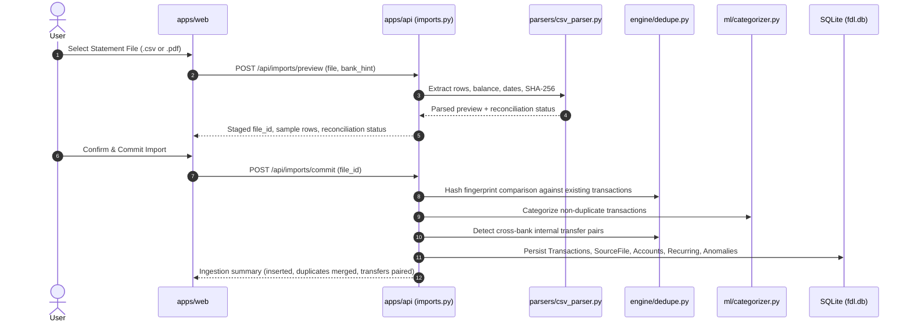
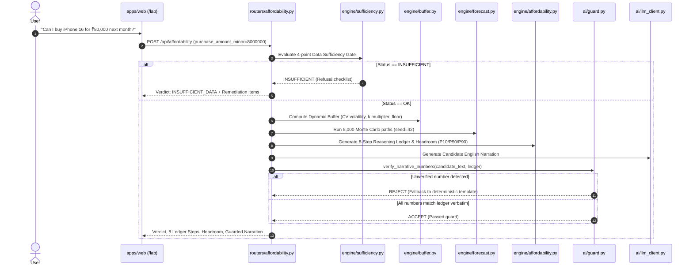

# Project Overview — Financial Decision Lab (FDL)

**Audit Date**: October 2026  
**Auditor**: Senior Software Architect, Backend Engineer & QA Lead  
**Scope**: Full Monorepo Architecture, Codebase Discovery, Runtime Behavioral Testing & Documentation Consistency  

---

## 1. Executive Summary & Purpose

**Financial Decision Lab (FDL)** is an evidence-backed personal financial decision support system designed specifically to answer one question with mathematical proof:
> *"Can I afford this next month?"*

Unlike conventional budget-tracking applications or generative AI financial chatbots that guess balances or hallucinate advice, FDL is built upon strict non-negotiable principles:
1. **Deterministic Financial Math**: 100% of calculations (balances, cash flows, safety buffers, headroom, EMI amortization, and affordability verdicts) are calculated by deterministic Python code. The LLM never calculates balances or makes decisions.
2. **Explainable Reasoning Ledger**: Every decision produces an 8-step step-by-step audit trail (`LedgerStep`) linking starting liquidity, expected cash flows, recurring obligations, discretionary spend, and safety buffers.
3. **Number-Verification Guard**: Every numerical figure, currency amount, or percentage generated by natural-language narration is validated by a strict regex guard ensuring it exists verbatim in the Reasoning Ledger before presentation to the user.
4. **Data Sufficiency Gate**: If uploaded statements contain less than 90 days of history, gaps > 7 days, or missing recurring income credits, the system refuses to speculate and returns an `INSUFFICIENT_DATA` verdict with an actionable remediation checklist.
5. **Local-First & Air-Gapped Privacy**: Sensitive bank statement text, account numbers, and transaction ledgers reside locally in an SQLite database (`fdl.db`). Outbound calls are logged to an audit table (`egress_log`).

---

## 2. Actual Technology Stack in Practice

The repository is configured as a Turborepo monorepo with `pnpm` for frontend/shared packages and a Python virtual environment (`.venv`) for the backend API.

| Layer | Documented Technology | Actual Verified Technology | Version Verified | Status |
|---|---|---|---|---|
| **Language (Backend)** | Python 3.13+ | Python 3.13.14 (Windows) | 3.13.14 | **VERIFIED** |
| **Framework (Backend)** | FastAPI, Uvicorn | FastAPI, Starlette, Uvicorn | FastAPI 0.162.0, Uvicorn 0.54.0 | **VERIFIED** |
| **Database / ORM** | SQLite + SQLAlchemy 2.0 | SQLite 3 + SQLAlchemy 2.1 ORM | SQLAlchemy 2.1.6 | **VERIFIED** |
| **Numeric & ML (Backend)** | NumPy, Pandas, SciPy, Scikit-learn | NumPy, Pandas, SciPy, Scikit-learn | NumPy 2.5.4, Pandas 3.1.0, SciPy 1.18.1, Scikit-learn 1.9.1 | **VERIFIED** |
| **Statement Extraction** | `pdfplumber`, `pypdf` | `pdfplumber`, `pypdf`, `pdfminer.six` | `pdfplumber` 0.11.10, `pypdf` 6.21.4 | **VERIFIED** |
| **Backend Testing** | `pytest`, `httpx` | `pytest`, `httpx`, `starlette.testclient` | `pytest` 9.2.0, `httpx` 0.28.1 | **VERIFIED** |
| **Monorepo Manager** | Turborepo | Turborepo | 2.11.10 | **VERIFIED** |
| **Package Manager** | `pnpm` | `pnpm` | 11.5.2 | **VERIFIED** |
| **Frontend Framework** | Next.js 14 App Router | Next.js 14.2.24, React 18.3.1 | Next.js 14.2.24 | **VERIFIED** |
| **UI & Styling** | Tailwind CSS 3.4, Framer Motion | Tailwind CSS 3.4.17, Framer Motion 14.8.0, Lucide React 0.475.0 | Current | **VERIFIED** |
| **Data Visualization** | Recharts | Recharts | 2.15.1 | **VERIFIED** |
| **Shared Contracts** | `@fdl/shared` | TypeScript library with types, constants, utilities | TypeScript 5.7.3, Zod 3.24.2 | **VERIFIED** |
| **LLM Integration** | Groq / Ollama / Gemini | Local Ollama (`http://localhost:11434`) + Google Gemini REST API | In `llm_client.py` | **VERIFIED** |

---

## 3. Repository Structure & Module Responsibilities

```
ISTE-Version-Beta---Beta-1/
├── apps/
│   ├── api/                     # Python FastAPI Backend Service
│   │   ├── main.py              # Application entrypoint, CORS, lifespan, router inclusion
│   │   ├── requirements.txt     # Python dependencies
│   │   ├── seed_demo.py         # Demo database seed utility (Aarav HDFC + SBI statements)
│   │   ├── ai/                  # AI narration, query parsing, and number guard
│   │   │   ├── extractor.py     # Regex & keyword natural language query extractor
│   │   │   ├── guard.py         # Regex Number-Verification Guard against ledger
│   │   │   ├── llm_client.py    # Local Ollama & Gemini REST clients with egress logging
│   │   │   └── narrator.py      # Guarded narrator & deterministic template fallback
│   │   ├── db/                  # SQLite & SQLAlchemy models and session
│   │   │   ├── database.py      # SQLite engine, SessionLocal, get_db(), init_db()
│   │   │   └── models.py        # 10 core tables (Account, Transaction, RecurringItem, etc.)
│   │   ├── engine/              # Deterministic financial calculation engines
│   │   │   ├── affordability.py # 8-step Reasoning Ledger & verdict evaluator
│   │   │   ├── anomaly.py       # Modified Z-Score & duplicate/new-merchant anomaly detector
│   │   │   ├── buffer.py        # Dynamic safety buffer (Floor vs Essentials vs Reserve)
│   │   │   ├── correction.py    # User category overrides & undo rollback logic
│   │   │   ├── dedupe.py        # Hash fingerprint deduplication & transfer pairing
│   │   │   ├── forecast.py      # 5,000-run Monte Carlo cash flow simulation
│   │   │   ├── job_queue.py     # In-memory background statement parsing queue
│   │   │   ├── ledger.py        # Ledger step data structures
│   │   │   ├── liquidity.py     # Multi-account aggregation & investment sourcing
│   │   │   ├── recurring.py     # Cadence clustering (weekly, monthly, annual) & confidence
│   │   │   └── sufficiency.py   # 4-point data gate evaluator
│   │   ├── middleware/          # Security & privacy middleware
│   │   │   └── egress.py        # Egress filter & audit logger
│   │   ├── ml/                  # ML & rule categorization
│   │   │   └── categorizer.py   # Merchant matching rules & Naive Bayes fallback
│   │   ├── parsers/             # Bank statement parsers
│   │   │   ├── bank_detector.py # Auto-detects bank brand & masked account digits
│   │   │   ├── csv_parser.py    # Auto-detecting CSV parser (HDFC, SBI, ICICI, etc.)
│   │   │   ├── normalizer.py    # Narration string cleaning & UPI stripping
│   │   │   └── pdf_parser.py    # Table & text extraction with password decryption
│   │   ├── routers/             # FastAPI APIRouter modules
│   │   │   ├── affordability.py # /api/affordability & /api/affordability/ask
│   │   │   ├── anomalies.py     # /api/anomalies & /feedback
│   │   │   ├── dashboard.py     # /api/dashboard & /investment-advice
│   │   │   ├── imports.py       # /api/imports/preview, /preview/async, /jobs, /commit
│   │   │   ├── privacy.py       # /api/privacy/status & /egress-log
│   │   │   ├── recurring.py     # /api/recurring & /upcoming
│   │   │   ├── sufficiency.py   # /api/sufficiency
│   │   │   ├── transactions.py  # /api/transactions, /corrections, /category, /undo
│   │   │   └── whatif.py        # /api/scenarios/compare
│   │   └── tests/               # Pytest integration & unit test suite (10 test files)
│   │
│   └── web/                     # Next.js 14 App Router React Frontend
│       ├── package.json
│       ├── next.config.mjs
│       ├── tailwind.config.ts
│       ├── tsconfig.json
│       └── src/
│           ├── lib/
│           │   └── api.ts       # Typed API client calling FastAPI
│           └── app/
│               ├── layout.tsx   # Root layout with navigation header
│               ├── page.tsx     # Executive Dashboard (KPIs, Cash Flow, Categories)
│               ├── lab/         # Affordability & What-If Simulation Lab
│               ├── transactions/# Transaction Explorer table & filters
│               ├── recurring/   # Subscriptions & recurring commitments
│               ├── anomalies/   # Spending spikes & duplicate charge alerts
│               └── privacy/     # Local-first verification & air-gap overview
│
├── packages/
│   └── shared/                  # Shared TypeScript Contracts & Utilities
│       ├── package.json
│       ├── tsconfig.json
│       └── src/
│           ├── index.ts         # Public re-export
│           ├── constants/       # PRD Appendix B domain constants & default categories
│           ├── types/           # Domain interfaces (Account, Transaction, LedgerStep, etc.)
│           └── utils/           # formatINR, rupeesToPaise, paiseToRupees
│
├── data/
│   └── synthetic/               # Synthetic bank statements for test & evaluation
│       ├── aarav/               # Salaried engineer (HDFC CSV + SBI CSV)
│       ├── priya/               # Freelance designer (volatile income ICICI CSV)
│       ├── short/               # 45-day statement (triggers Sufficiency refusal)
│       ├── gappy/               # Statement with missing calendar gaps
│       └── generate_statements.py # Statement generator script
│
└── docs/                        # Specifications, Architecture, & PRD
    ├── PRD_Financial_Decision_Lab.md
    ├── ARCHITECTURE.md
    ├── DOMAIN_ENGINE_SPEC.md
    ├── API_REFERENCE.md
    ├── API_PROPS_AND_ENDPOINTS.md
    ├── DATABASE_SCHEMA.md
    ├── DEVELOPMENT_WORKFLOW.md
    └── project-audit/           # Comprehensive audit package (this directory)
```

---

## 4. Key Execution Flows

### 4.1 Statement Ingestion & Deduplication Pipeline


### 4.2 Affordability Decision & Number Guard Pipeline


---

## 5. External Integrations & Dependencies

1. **Local-First Air-Gap**: The core application has **zero required external network dependencies**. All mathematical calculations, deduplication, statement parsing, and Monte Carlo forecasts run entirely in-process.
2. **Optional Ollama Local Server**: If installed on `http://localhost:11434`, the system queries local Llama 3.2 without sending any data over the internet.
3. **Optional Google Gemini API**: If `GEMINI_API_KEY` is set in the environment, the LLM client can call Google Gemini (`gemini-1.5-flash`) for narrative summarization, strictly guarded by the Number-Verification Guard and logged to `egress_log`.

